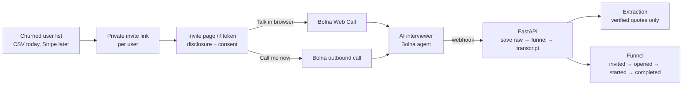

# ChurnCall

**Your churned users will tell you exactly why they left. Someone just has to call them.**

ChurnCall is an AI voice interviewer for SaaS companies. When a user cancels, downgrades or goes quiet, ChurnCall invites them to a short conversation, either one tap in the browser or a phone call they ask for. A [Bolna](https://www.bolna.ai) voice agent runs a proper research interview with real follow-up questions. ChurnCall then turns every call into evidence a founder can act on: the real reason they left, what they switched to, the features they missed, whether they could be won back, and the exact quotes behind each point.

Built by Sarthak and Pranav for the **[Bolna Buildathon @ Symphony 2026](hackathon-details.md)**.

---

## Why

- **Exit surveys don't explain churn.** Users click "too expensive" (often not the real reason), and few answer at all.
- **Founders know they should talk to churned users,** but nobody has time to chase 40 people a week for a call.
- **A conversation gets the real story.** "Too expensive" turns into "we only used it for one report a month" after two good follow-up questions. That's the interview ChurnCall runs, every time, for every user who agrees.

## How it works



1. **Invite.** Each churned user gets a private link, sent in an email from the founder.
2. **Consent first.** The page says up front that this is an AI and that the conversation is recorded. The user chooses to talk in the browser or ticks a box asking to be called. **We never cold-call**, and the server refuses to dial without that consent.
3. **Interview.** A ~3 minute conversation built on jobs-to-be-done (what they hired the product to do): the story of signing up, the moment it broke, what they use now, what would bring them back. At least two follow-ups on the main reason, and it never suggests an answer.
4. **Evidence.** Each call becomes a structured record. **Every quote is checked word for word against the transcript;** anything the model invents is dropped.
5. **Funnel.** Unique users at each stage, split by channel, incentive and email variant. That's how we measure whether churned users will actually talk.

## Status (Oct 28, 2026)

| | |
|---|---|
| ✅ Invite flow | Links from a CSV, invite page, browser calls and "call me now", Bolna webhook → funnel ([build plan 01](build-plans/01-invite-page.md)) |
| ✅ Interviewer | Bolna agent created from `agents/interviewer/`, with different openers for phone and browser |
| ✅ Evidence | Structured extraction with verified quotes, on Claude or any free OpenAI-compatible model |
| ✅ Architecture | Layered API with safety fixes and regression snapshots ([build plan 02](build-plans/02-api-architecture-cleanup.md)) |
| ✅ Results | Password-protected `/results`: funnel, reasons with verified quotes, every call's transcript and insight ([build plan 03](build-plans/03-results-page.md)) |
| ✅ First real interview | Oct 20, browser call, end to end. Its weaknesses (AI talked 71% of the words, double questions) drove interviewer prompt v2 |
| ✅ Quality checks | `eval/interviews/quality.py` scores any transcript (talk ratio, words per turn, double/leading questions) and runs in tests |
| ⏳ Next | Test call on prompt v2, the pilot, then submission ([submission kit](docs/SUBMISSION.md)) |
| 🎯 Pilot | Will churned users actually talk to an AI? A small private pilot (2 startups, 10+ interviews), measured on `/results`: see [Sarthak's plan](build-plans/00-sarthaks-plan.md) |

---

## Architecture

```
apps/web  (Next.js 15)          the invite page; forwards only /api/invites/* and /api/bolna/webhook
   │
apps/api  (FastAPI, package "churncall")
   api/          HTTP only: routes, auth, domain errors → status codes
   calls · webhooks · funnel · invites      use cases (the business rules)
   interview · extraction                   prompt variables, quote-verified insights
   store · bolna · llm                      adapters: files, Bolna's API, LLM providers
   config                                   every env var, read in one place
agents/interviewer   Bolna agent prompt ({{variables}}) + settings, pushed by agents/sync.py
```

Dependencies only point downward. Only `config.py` reads environment variables, only `store.py` touches files, and only `bolna.py` knows Bolna's request and response shapes. Details and reasoning are in [build plan 02](build-plans/02-api-architecture-cleanup.md) and [apps/api/README.md](apps/api/README.md).

| Layer | Choice |
|---|---|
| Voice | **Bolna**: Web Call SDK (browser), outbound calls, agent API |
| Interviewer model | GPT-4.1-mini via Bolna · ElevenLabs voice · Deepgram nova-3 transcription |
| Extraction | Claude by default, or any OpenAI-compatible endpoint (e.g. Groq), switched in `.env` |
| API | Python 3.12+, FastAPI, Pydantic |
| Web | Next.js 15, React 19 |
| Storage | JSONL files for the kill test → Supabase after a "go" (only `store.py` changes) |

## Run it locally

**Needs:** Python 3.12+, Node 20+, a Bolna account (API key + agent), and optionally ngrok for a public URL.

```bash
# 1. API
python3 -m venv .venv && .venv/bin/pip install -e "apps/api[dev]"
cp .env.example .env                          # fill in BOLNA_API_KEY, ADMIN_KEY, CHURNCALL_DATA_DIR, ...
.venv/bin/python agents/sync.py               # creates the Bolna agent and saves BOLNA_AGENT_ID to .env
cd apps/api && ../../.venv/bin/uvicorn churncall.main:app --port 8000

# 2. Web (another terminal)
cd apps/web && npm install && cp .env.example .env.local && npm run dev

# 3. Invite someone
mkdir -p data/companies && echo '{"name":"Acme","product_description":"invoicing software","founder_name":"Priya"}' > data/companies/acme.json
printf 'name,email\nAsha,asha@example.com\n' > /tmp/acme.csv
.venv/bin/python scripts/make_invites.py --company acme --csv /tmp/acme.csv --base-url http://localhost:3000
# → open the link it prints

# 4. Results
curl -H "X-Admin-Key: $ADMIN_KEY" localhost:8000/admin/funnel
```

For Bolna to reach your webhook, run `ngrok http 3000`, set `PUBLIC_BASE_URL` to the ngrok URL and re-run `agents/sync.py`. Free ngrok shows visitors a warning page first, so use a paid plan or a real deploy before inviting real users.

## Tests

```bash
.venv/bin/python -m pytest -q apps/api/tests            # 44 tests; never reads your real .env
cd apps/web && npm run lint && npx tsc --noEmit && npm run build
```

`apps/api/tests/test_characterization.py` pins the business behaviour with snapshots (what Bolna receives, the funnel numbers, a replayed webhook stream, the status codes the page depends on). A snapshot only changes on purpose (`UPDATE_SNAPSHOTS=1`).

## Repo map

| Path | What |
|---|---|
| [docs/CHURNCALL.md](docs/CHURNCALL.md) | Product spec: problem, product, architecture, evals, business |
| [build-plans/00-sarthaks-plan.md](build-plans/00-sarthaks-plan.md) | Sarthak's plan: the pilot to Oct 30 (with notes on what's already built) · pilot numbers in [docs/pilot-log.md](docs/pilot-log.md) |
| [build-plans/](build-plans/) | One plan per feature, with steps and checks |
| [docs/research/](docs/research/) | Evidence base and the Koji / Perspective AI teardown |
| [docs/suggested-improvements.md](docs/suggested-improvements.md) | Analysis of the first real interview and the prioritised improvement list |
| [docs/HANDOFF_2026-10-20.md](docs/HANDOFF_2026-10-20.md) · [docs/BOLNA_QUESTIONS.md](docs/BOLNA_QUESTIONS.md) | Latest handoff between us; open questions for Bolna |
| [apps/api/](apps/api/README.md) · [apps/web/](apps/web/) | The API and the invite page |
| [agents/](agents/) · [eval/](eval/) · [scripts/](scripts/) | Bolna agent, interview simulator, invite generator |
| [archive/](archive/README.md) | Ideas we considered and dropped (reference only) |
| [CLAUDE.md](CLAUDE.md) | Project context for AI coding assistants |

## Privacy and consent

- Users always start the conversation. Every call opens with an AI and recording disclosure.
- Real user data (`data/`) and secrets (`.env`) are gitignored and never committed.
- The API key never reaches the browser: browser calls use single-use sessions minted by our server.
- Every invite page has an opt-out, and any user can ask for their data to be deleted.

## Key dates

Submission **Oct 30** (deadline Oct 31) · Grand finale **Nov 20, 2026**, Bengaluru.
